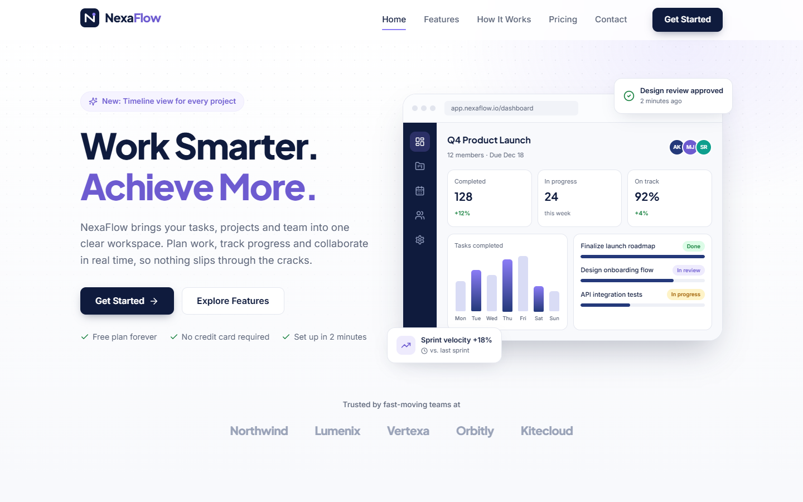
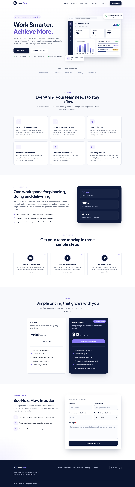
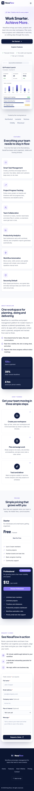
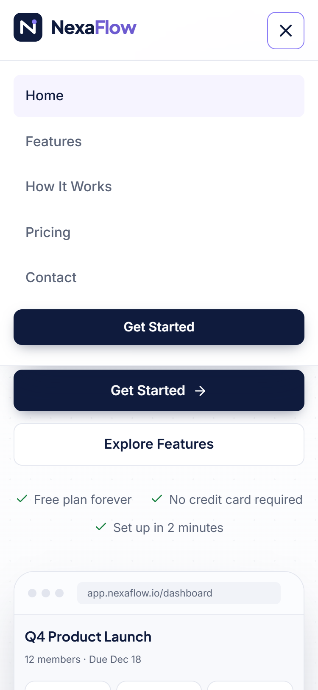

# NexaFlow — SaaS Landing Page

A responsive marketing landing page for **NexaFlow**, a fictional workflow and project management platform. Built with React and Vite as a front-end development internship project.



## Overview

The page introduces NexaFlow to potential customers and guides them toward requesting a demo. It contains six sections: navigation, hero, features, about / how it works, pricing, and a demo request form with client-side validation.

> **Note:** This is a frontend-only project. There is no backend or database. The demo request form validates input in the browser and shows a success message, but **no data is sent to a server or stored anywhere**.

## Features

- **Sticky navigation** with smooth scrolling, active-section highlighting and an accessible mobile hamburger menu (closes on link click, Escape, or resize to desktop)
- **Hero section** with a dashboard mockup built in HTML/CSS (no image files)
- **Six feature cards** with Lucide icons and hover effects
- **About + three-step "How It Works"** layout
- **Two pricing plans** (Starter: Free, Professional: $12/month) with a highlighted recommended plan; pricing buttons scroll to the form and pre-select the chosen plan
- **Demo request form** with required-field and email-format validation, inline error messages, a loading state and a success message (no page reload) that states it is a frontend demonstration and no data is transmitted
- **Scroll-reveal animations** that respect the user's `prefers-reduced-motion` setting
- **Accessibility:** semantic landmarks, labelled form fields, `aria-invalid` / `aria-describedby` on errors, a skip link and visible focus states
- **Responsive layout** for desktop, tablet and mobile (tested down to 320px wide)

## Technologies

| Tool | Purpose |
| --- | --- |
| React 18 | Component-based UI |
| Vite 6 | Dev server and production bundler |
| JavaScript (ES modules) | Interactivity and form logic |
| CSS3 | Custom properties, Grid, Flexbox, media queries, animations |
| Lucide React | Icon set |

## Project Structure

```
nexaflow-landing-page/
├── index.html              # HTML shell, meta tags, Google Fonts
├── public/favicon.svg      # Brand icon
├── screenshots/            # Desktop and mobile screenshots
├── src/
│   ├── main.jsx            # Entry point — mounts <App />
│   ├── App.jsx             # Page layout and shared "selected plan" state
│   ├── components/         # Reusable UI components (one per section + helpers)
│   ├── data/content.js     # All text content: nav links, features, steps, plans
│   ├── hooks/useScrollReveal.js  # Fade-in-on-scroll behaviour
│   └── styles/             # global.css (tokens, buttons) + one CSS file per section
├── vite.config.js          # Vite configuration (React plugin)
├── netlify.toml            # Netlify build settings
├── package.json            # Scripts and dependencies
└── package-lock.json       # Exact dependency versions
```

## Getting Started

**Requirements:** Node.js 18, 20 or 22+ and npm.

```bash
# 1. Get the code and open the project folder
git clone <your-repository-url>
cd nexaflow-landing-page

# 2. Install dependencies
npm install

# 3. Start the development server (http://localhost:5173)
npm run dev

# 4. Create a production build in the dist/ folder
npm run build

# 5. Preview the production build locally (http://localhost:4173)
npm run preview
```

## Deployment

The project is ready to deploy as a static site.

- **Vercel:** Import the repository; Vercel detects Vite automatically (build command `npm run build`, output directory `dist`).
- **Netlify:** Import the repository; `netlify.toml` already sets the build command and the `dist` publish folder.

## Design Decisions and Challenges

- A white/light base with a deep navy primary color and a single purple accent keeps the brand professional and avoids heavy gradients.
- The hero dashboard is built from HTML and CSS rather than an image, so it stays sharp at every size and adapts to mobile by hiding the sidebar and stacking panels.
- All copy lives in `src/data/content.js`, so components focus on layout and content can be edited in one place.
- Smooth scrolling uses native anchor links with CSS `scroll-behavior` and `scroll-margin-top`, so sections are not hidden behind the fixed navbar and links still work without JavaScript.
- Scroll reveals use a CSS keyframe animation instead of a transition, so they do not conflict with the cards' hover lift effects.
- The form validates on blur and on submit, moves focus to the first invalid field, and moves focus to the success message, so keyboard and screen-reader users get clear feedback.
- Layouts were checked at 1440px, 820px, 375px and 320px to make sure there is no horizontal overflow.

## Screenshots

**Desktop — full page**



| Mobile — full page | Mobile — navigation menu |
| --- | --- |
|  |  |

More screenshots: [`desktop-hero.png`](screenshots/desktop-hero.png) (hero section) and [`desktop-contact-success.png`](screenshots/desktop-contact-success.png) (form success state).
